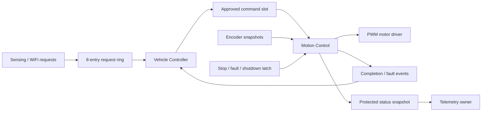

# INF2004 SmartRobo — Buddy 2

Motion control for a Robo Pico / Raspberry Pi Pico W, in C with the real micro
T-Kernel 3.0 Pico BSP and Pico SDK. Normal startup waits safely: no navigation demo,
network connection, or invented sensor data runs. **Motor motion is inhibited by
default** because the physical board, encoders and geometry have not been confirmed.

Implemented: signed dual PWM, brake/coast and reversal delay, quadrature/single
channel encoders, odometry, independent speed PID, straight-distance control,
encoder turns, continuous steering, finite manual pulses, cancellation/hold,
guarded reset, terminal shutdown, local fault latching, and seven task entry points.

Start with [build/flash instructions](docs/BUILD.md), [API and communication](docs/API.md),
[hardware evidence](docs/HARDWARE.md), and [controlled calibration](docs/CALIBRATION.md).
[Verification](docs/VERIFICATION.md) distinguishes executed tests from hardware work.
Use the blank [PID report](docs/PID_REPORT_TEMPLATE.md) and
[accuracy report](docs/MOTION_RESULTS_TEMPLATE.md) for measurements.

| Owner | Files to extend |
|---|---|
| Buddy 2 | `src/control/`, `src/hal/pico_motion.c`, `src/config/board_config.c` |
| Vehicle Controller / integration | `src/app/vehicle_controller.c`, `src/app/tasks.c` |
| Buddy 1 WiFi/MQTT | `wifi_task` in `src/subsystems/placeholders.c`; read snapshot via `robot.h` |
| Buddy 3 line + barcode | `line_task` and `barcode_task` in the same file |
| Buddy 4 heading/terrain | `terrain_task`; confirm actual sensing capabilities first |
| Buddy 5 obstacle/servo | `obstacle_task`; use reserved GP12/16/17 |

Each placeholder is compilable and sleeps. Split it into its own module when the
real subsystem is ready. Shared types are in `include/robot.h`; only Motion Control
writes DC motor outputs in normal operation. Startup/fatal shutdown force stopped
GPIO levels as an explicit exception.

Stop bypasses ordinary messages and invalidates stale generations. Faults remain
local and inhibit movement even if event delivery fails. Feedback loss cannot be
cleared merely by observing no pulses. Reset and release require explicit checks;
shutdown prevents any later restart during that boot.

The supplied project briefing was reviewed as requirements context, separately
from the pasted implementation request. The diagrams are reflected in the design,
with contradictory stopping/fault guards corrected and documented in API.md.
